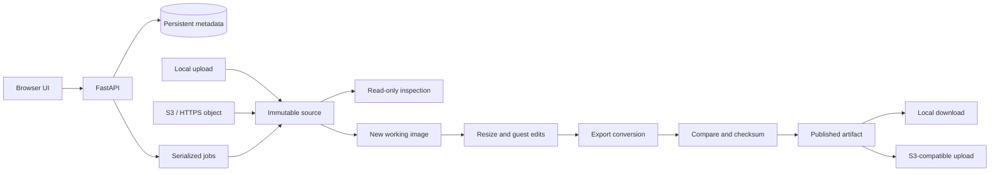

# Architecture and validation

Cloud Image Forge has one HTTP service and one serialized image worker per data directory. The browser submits import/build/upload jobs, polls durable job state, and downloads completed artifacts through the API. QEMU and libguestfs perform disk operations in a Linux appliance.

## Image lifecycle

An import first receives the image into application-owned storage. A narrowly supported OCI archive is unpacked only when it contains exactly the regular files `output.QCOW2` and `image_metadata.json`; arbitrary archive paths and links are rejected. Inspection determines the disk's actual format and virtual capacity, rejects unsupported dependencies, and mounts the detected Linux guest read-only inside libguestfs. No guest filesystem is mounted on the API host. The inspection result supplies file contents and device information to the editor.

A build reads the immutable source and creates a new working image. The recipe uses structured fields for partition changes, service actions, package operations, and file edits. It does not accept host shell commands. Guest commands required for bootloader/package changes run inside the libguestfs appliance. The engine uses explicit argument arrays for host tools and restricts editable guest paths.

x86_64 and ARM64 source images are supported. Disk/data operations can cross worker architectures, while guest-program execution requires a matching architecture worker. Runtime checks reject incompatible execution before writes; final inspection must retain the source architecture. The Dockerfile selects a native x86 or ARM appliance. See [the architecture operation matrix](image-architectures.md).

Sparsification runs against the working copy. The output is converted to the selected provider format, checked when the format supports consistency checking, compared against the prepared working disk, and hashed. Comparisons verify conversion integrity; they do not compare the customized image to the original, which is expected to differ.

Compression affects physical transfer size. Resizing affects virtual capacity. Azure and Google export alignment may increase virtual capacity to satisfy format requirements without growing a filesystem into that additional space.

## Boot-mode evidence

Inspection returns `boot.mode` (`uefi`, `bios`, `dual`, or `unknown`), `supported_firmware`, an optional single-mode recommendation, evidence, warnings, and `boot_tested: false`. It probes partitions read-only before mounting the guest OS. This includes EFI partitions absent from the guest's `fstab`; libguestfs explicitly describes its inferred mountpoints as configuration-derived guesses. [libguestfs inspection API](https://libguestfs.org/guestfs.3.html#guestfs_inspect_get_mountpoints)

UEFI evidence requires a FAT EFI system partition and a recognized loader or Unified Kernel Image matching the inspected x86_64/ARM64 architecture, with bounded, structurally valid PE headers, sections, and an executable entry point. The PE subsystem must be EFI application (10); EFI drivers and ordinary diagnostic applications do not establish support. `BOOTX64.EFI` and `BOOTAA64.EFI` are matched to their respective PE machine types. A loader on an unmarked FAT partition is reported without advertising firmware support. [UEFI media discovery](https://uefi.org/specs/UEFI/2.11/13_Protocols_Media_Access.html), [PE format](https://learn.microsoft.com/en-us/windows/win32/debug/pe-format)

BIOS evidence checks GRUB MBR code, the referenced core loader, its bounded blocklist and terminator, and nonempty referenced payload within the MBR embedding gap or GPT BIOS Boot Partition. GPT can support BIOS; neither partition-table style nor a reserved partition proves an installed bootloader. SYSLINUX/EXTLINUX and LILO candidates remain unverified when their complete boot chain is unsupported. [GRUB BIOS installation](https://www.gnu.org/software/grub/manual/grub/html_node/BIOS-installation.html), [GRUB disk loader source](https://sources.debian.org/src/grub2/2.06-13%2Bdeb12u2/grub-core/boot/i386/pc/diskboot.S/)

These checks establish recognizable disk structures, not executable correctness or successful kernel startup. They cannot recover a previous VM's firmware choice, firmware NVRAM, or Secure Boot trust. Vendor-only EFI loader paths receive a warning because a matching destination boot entry may be needed. Dual support stays explicit; unknown results are not converted into a guessed firmware choice. Actual boot validation requires isolated SeaBIOS/OVMF launches on matching virtual hardware and then a destination cloud launch. [UEFI boot manager](https://uefi.org/specs/UEFI/2.11/03_Boot_Manager.html)

`POST /api/images/{image_id}/inspect` queues a refresh against the preserved source. The image remains `ready` with its prior result while `inspection_status` records `queued`, `running`, `ready`, or `failed`; a successful refresh replaces the result and updates `inspected_at`. Failure or restart retains the previous result. Builds and OCI plans are blocked during an active refresh, and the browser preserves the customization draft.

## BIOS-to-UEFI migration

Migration is an explicit recipe operation: `boot_migration: {"enabled": true, "esp_size_mib": 512, "install_packages": false}`. `POST /api/images/{image_id}/uefi/plan` accepts that object and `allow_network` to preview eligibility, package requirements, disk growth, and blockers against the imported source. It does not simulate the recipe's storage or package edits. An existing UEFI-capable image needs no migration. Other images require detected BIOS support, validated partition geometry, supported guest tooling, a stable boot filesystem UUID, and installed kernels with EFI support and initramfs.

The engine applies ordinary guest edits first, reinspects the working disk, and replans migration. It reuses a suitable existing ESP or appends one beyond the old disk end. GPT expansion relocates the backup table before adding the partition. Only the new partition is formatted; its exact bounds and FAT32 structures are checked. Original partition identities and boundaries and BIOS boot structures are checked before and after migration. It does not convert MBR to GPT or shrink or move existing filesystems. [libguestfs partition APIs](https://libguestfs.org/guestfs.3.html#guestfs_part_expand_gpt)

Debian/Ubuntu use guest `grub-install` with an explicit x86_64 EFI target, the mounted ESP, `--no-nvram`, and `--removable`. The EFI module package can coexist with BIOS GRUB. Supported RPM guests use package-provided GRUB executables, verify their package ownership and contents, and install a direct EFI fallback with UUID-based forwarding configuration. Their main configuration remains `/boot/grub2/grub.cfg`; the ESP contains a forwarding stub. Secure Boot is outside this migration path. [GNU GRUB EFI installation](https://www.gnu.org/software/grub/manual/grub/html_node/Installing-GRUB-using-grub_002dinstall.html), [Debian EFI module package](https://packages.debian.org/bookworm/grub-efi-amd64-bin), [Fedora unified GRUB configuration](https://fedoraproject.org/wiki/Changes/UnifyGrubConfig)

The output guest retains backups under `/var/lib/cloud-image-forge/uefi-backups/`. Final inspection must find the fallback loader and both firmware arrangements after subsequent OCI preparation, sparsification, and export alignment. These checks do not execute the boot chain: package updates can also affect BIOS GRUB modules, and both desired firmware modes need a VM boot test. A migration failure discards the unpublished working build while preserving the imported source.

## Filesystem rebuild and machine profiles

`storage_rebuild` selects a separate new-disk reconstruction path. Read-only inspection records filesystem capacity, GPT identities and simple LVM topology. The planner accounts for all partitions and filesystems, preserves the ESP, and rejects unsupported boot arrangements, data volumes and identity pins. Archive manifests verify restored file contents and metadata, and the engine repeats disk/filesystem identity checks after customization, sparsification and provider alignment. Failure removes only unpublished output. Previewed and actual sizes are included in the artifact manifest. See [supported storage workflows](storage-and-platform.md).

`platform_migration` prepares VM or experimental bare-metal hardware profiles. A source image cannot reveal the destination physical NIC, so hardware networking requires an explicit driver. Plans use installed per-kernel evidence and supported guest tooling. Preparation adapts UUID mounts, boot transport, initramfs, networking and serial settings in the working copy. Standard GRUB environment variables are resolved as data; unrecognized dynamic substitutions are rejected. Driver verification receipts are bound to the exact kernel, initramfs path and content hash. These receipts do not prove a hardware boot.

Order is storage resize/rebuild, ordinary edits, optional BIOS-to-UEFI migration, machine preparation, OCI preparation, sparsification, reinspection and output alignment. OCI previews can use explicitly planned machine changes only after that machine plan is valid. Actual OCI preparation runs against the modified disk and retains required physical drivers. Final storage and platform verification must pass before publishing the artifact. Provider support remains separate: OCI currently documents BYOI to bare metal as unsupported.

## Storage and process model

The application stores image metadata, job status/logs, and artifact records alongside image files under `FORGE_DATA_DIR`. A single worker serializes expensive operations. The API process can still serve polling, configuration, and downloads while that worker runs.

Run one process and one replica per data directory. An exclusive process lock rejects a second worker opening the same directory. This implementation is not a distributed queue. Restart recovery marks interrupted operations failed and removes incomplete source imports and unpublished build directories, preserving successful sources and artifacts. It does not resume a partially executed guest customization. Retrying a build starts from the source again.

The container runs as UID 10001. The supplied named volume is initialized with writable ownership. A manually bind-mounted data directory and its `tmp` subdirectory must be writable by that UID. Multipart uploads spool into `/data/tmp` before being copied into a source directory, so temporary and source copies share the data volume's capacity. The appliance cache lives separately under `/var/tmp/forge`. The appliance uses a kernel supplied in the container image; it does not need the host's `/boot` or `/lib/modules` mounted into the container. KVM is an optional acceleration device.

## Guest support boundary

The initial target is a single-disk Linux guest with an inspectable operating system. Support for an image container format does not imply support for every guest layout, filesystem, architecture, or boot configuration carried by that container.

Particular care is required for these cases:

- XFS shrinking requires a new filesystem and metadata-preserving restore. It is not implemented as a disk truncation.
- Filesystem/LVM resize operations must preserve live data. Unsupported layouts fail rather than guessing how to move partitions.
- Regenerating GRUB requires the guest's appropriate tooling. Bootloader files and UEFI firmware settings differ across distributions and cloud platforms.
- Kernel package operations need compatible repositories and usually network access. Enabling network access is an explicit recipe option.
- `fstab`, service units, cron syntax, module settings, and boot arguments are administrator-supplied configuration. Successful file editing cannot establish that these settings will work at boot.
- Filesystem UUID and SELinux label preservation matters when copying/rebuilding data. The provided Oracle Linux record is evidence for its specific layout, not validation of all image layouts.

## Object storage and authentication

The API supports local uploads, public/presigned HTTPS objects, and `s3://` object references. S3 operations use server-side SDK credentials and an optional custom endpoint. Credential secrets are not part of the recipe or browser forms. Presigned URLs themselves are sensitive and should be treated as temporary credentials.

Object size limits and virtual disk limits are independent. A small compressed image may expand into a very large virtual disk. Endpoint policy defaults to excluding private destinations; deployments that explicitly enable private endpoints should be restricted to trusted operators.

An optional shared API token protects the service. The browser obtains a session cookie; API clients can use bearer authentication. Localhost binding is the deployment default. Multiuser authorization, per-tenant storage, audit-grade access control, and distributed worker isolation are outside this version's scope.

## Validation levels

| Level | What it establishes | What it does not establish |
| --- | --- | --- |
| Unit/API tests | Request validation, state transitions, command construction, error handling | Real appliance/tool execution |
| Container build and health | Dependencies install, API starts and serves requests | A libguestfs appliance can boot |
| `libguestfs-test-tool` | Appliance startup and basic disk access | Correctness for a particular imported guest |
| `scripts/smoke-image.sh` | Real source inspection, persisted guest edit, artifact checksum, unchanged source | Guest boot or cloud support |
| QEMU consistency check | Supported image-container metadata consistency | Filesystem, application, or cloud correctness |
| Guest-byte comparison | Conversion preserved the prepared disk's guest-visible bytes | Correct configuration of those bytes |
| Isolated VM boot | Guest reaches the expected boot state on the tested virtual hardware | Destination cloud acceptance |
| Provider import and launch | Artifact works with tested cloud settings and instance shape | Compatibility with every provider shape or future environment |

The application reports output as a candidate until external boot and destination tests are performed. It does not silently claim the higher validation levels from lower-level checks.

## References

- [libguestfs API and isolation model](https://libguestfs.org/guestfs.3.html)
- [virt-resize behavior](https://libguestfs.org/virt-resize.1.html)
- [virt-customize guest modifications](https://libguestfs.org/virt-customize.1.html)
- [QEMU disk image utilities](https://www.qemu.org/docs/master/tools/qemu-img.html)
- [OCI custom image import](https://docs.oracle.com/en-us/iaas/Content/Compute/Tasks/custom-images-import.htm)
- [AWS VM Import/Export requirements](https://docs.aws.amazon.com/vm-import/latest/userguide/prerequisites.html)
- [Azure Linux image preparation](https://learn.microsoft.com/en-us/azure/virtual-machines/linux/create-upload-generic)
- [Google Cloud manual disk import](https://docs.cloud.google.com/compute/docs/import/import-existing-image)
