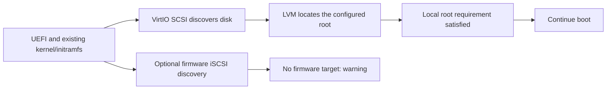

# Storage rebuild and machine preparation

These workflows operate on offline x86_64 and ARM64 Linux disk images. The imported source is preserved, each build uses independent working files, and only a complete validated artifact is published. See [image/worker architecture requirements](image-architectures.md); guest-executing operations require a worker matching the guest.

## Automatic mount references

**Mounts → Mount references → UUIDs · automatic** is the default (`mount_policy: "auto"`). Forge reads the actual output filesystems and mounted devices, resolves local device, label, partition and LVM references, and updates their `fstab` source fields to filesystem UUIDs. This includes Ubuntu installer paths such as `/dev/disk/by-uuid/...` and `dm-uuid-LVM` aliases proved from the actual VG and LV identifiers. Mount options, comments, remote mounts, optional future volumes, bind mounts and swap files are retained.

**Prefer labels** (`mount_policy: "labels"`) uses `LABEL=` only when an existing filesystem label uniquely identifies that filesystem and can be represented safely. Missing, duplicate or unsafe destination labels use the verified filesystem UUID instead; the preview shows each fallback. Existing ambiguous source references still block reconciliation. Spaces and tabs in safe labels are escaped for `fstab`. Forge does not create labels or change UUIDs. Kernel and GRUB root arguments retain their independently verified UUID identity. Labels can also collide when disks are cloned, so selecting them does not bypass identity checks.

`POST /api/images/{image_id}/mounts/plan` accepts `{"mount_policy":"labels"}` (or `auto`/`preserve`) and returns a read-only preview from hash-verified original `fstab` and inspection evidence. It creates no job or disk writes. A missing or stale proof requires refreshed inspection; every build checks the actual working disk again.

Moving a disk between a VM and bare metal does not itself change its filesystem UUIDs. Forge keeps those identities rather than generating new ones unnecessarily. Rebuild also retains filesystem UUIDs while recreating internal LVM IDs, so filesystem UUID references remain stable. A stale root reference can be repaired using the independently identified OS root. Other stale references need an observed mount or a unique verified identity mapping; duplicate or conflicting identities block automatic repair.

Reconciliation runs before storage rebuild and after explicit edits, with fresh identity and `fstab` verification before export. A repaired critical reference also requires verified boot and initramfs references; correcting `fstab` alone does not establish a bootable image. True changes to a boot filesystem UUID require a separately verified boot update and are blocked by this workflow. The artifact records the actual mount changes and identity map. Select **Mount references → Keep current** to keep the original `fstab`; unresolved references are then retained and reported without claiming they were repaired. Hardware preparation additionally requires proven stable selectors; raw appliance names such as `/dev/sda2` do not prove portability to another boot transport.

## Disk and filesystem sizing

The Storage step separates **virtual disk capacity**, **filesystem capacity**, **used data**, and the imported **file length**. A smaller virtual disk does not predict the size of compressed QCOW2 output or the boot volume a cloud provider will provision. Filesystem reduction does not reduce the outer disk unless a smaller target disk is also selected.

The **Disk & filesystems** card combines the current/planned disk comparison, capacity choice and filesystem rows. **Automatic** keeps the current disk capacity unless filesystem targets require more space. **Custom size** reveals the capacity field and remembers the last custom entry for that image. Turn on **Resize filesystems** to adjust editable filesystems using their slider or numeric field. Numeric fields accept GiB or MiB; GiB values round upward to whole MiB, and ordinary LVM sizes round upward to 4 MiB extents. Fixed EFI partitions retain their original capacity. With resizing off, a larger custom disk fills the independently verified root filesystem when its containing partition is last and unambiguous. With resizing on, the explicit filesystem capacities are retained; additional disk space is not silently assigned to a volume. The bars show used space, planned capacity, and hatched space removed from the original allocation.

Choose **Fit to filesystems** beside the capacity controls to calculate the minimum outer disk for the selected filesystem sizes, including layout metadata, rounded upward to two decimal places in your selected unit. This uses the server's planner and checks the resulting target again. It does not choose smaller filesystem sizes for you; refit after changing those sizes. **Check sizes** and **Next** validate the current plan; estimates do not guarantee that every archive will fit.

Target disk capacity accepts binary GiB or decimal GB. Arbitrary target capacities round upward to a 512-byte boundary; **Disk layout** shows the actual byte count and partition maps. For example, 10 GB is exactly 10,000,000,000 bytes, or 9.313225746154785 GiB.

The server chooses between growth and verified filesystem rebuild from the requested sizes. Increasing an ext2/3/4 or XFS filesystem automatically grows its containing partition, PV and LV when required; no separate expansion device needs to be selected. Reducing a filesystem or the disk uses the existing rebuild workflow and its stricter eligibility checks below. The read-only preview is available through `POST /api/images/{image_id}/storage/plan`:

```json
{
  "disk_size_gib": 9.313225746154785,
  "storage_resize": {
    "enabled": true,
    "sizes": [
      {"device": "/dev/sda2", "size_mib": 512},
      {"device": "/dev/ocivolume/root", "size_mib": 8192},
      {"device": "/dev/ocivolume/oled", "size_mib": 512}
    ]
  }
}
```

The same fields are included in a build recipe. Devices and minimums must come from that image's inspection; this example is not a universal layout. `storage_resize` cannot be combined with legacy `storage_rebuild`, `partition_changes`, `expand_partition`, or `expand_lv` actions. Those older API fields remain supported for existing clients. The plan reports `mode` (`growth`, `rebuild`, or `unchanged`), inferred container changes, selected filesystem capacities and any blockers.

Growth supports a validated GPT or simple primary MBR disk with 512-byte sectors, direct ext/XFS filesystems, and optionally one ordinary single-PV VG with single-segment writable LVs and 4 MiB extents. It retains partition starts, disk and partition identities, filesystem UUIDs/labels and PV/VG/LV identities. An existing PV may use either its standard LVM type or a proved Linux-data GPT partition. Unknown data, complex LVM mappings, missing capacity evidence and changes that would overlap a following partition are blocked. Existing VG free space is used before the PV needs expansion. Explicit LV sizes are applied individually and are not expanded to consume all VG free space.

The engine applies [partition-end growth](https://libguestfs.org/guestfs.3.html#guestfs_part_resize), then [PV growth](https://libguestfs.org/guestfs.3.html#guestfs_pvresize), exact [LV capacities](https://libguestfs.org/guestfs.3.html#guestfs_lvresize) and the filesystem's own grow operation on an independent copy. Final verification checks both block-device capacity and actual filesystem data capacity, plus retained partition, filesystem and LVM identities. Growth can retain an existing BIOS layout without relocating its boot code; a boot test is still required. Rebuild has the narrower UEFI-only scope below.

For a rebuild, unspecified filesystems keep their current capacities, the PV occupies the planned remaining space, and LVs use ordinary 4 MiB extents.

The engine verifies the new GPT layout and exact partition names before archiving, including empty names. Rebuild supports partition names containing at most 36 printable ASCII characters, including spaces and quotes; non-ASCII names and backslashes are blocked because the current appliance cannot preserve and read them back reliably. It exports each supported filesystem separately with numeric ownership, ACLs, extended attributes and SELinux labels. Tar creation/restoration stays inside the appliance; gzip compression/decompression runs on the native worker CPU. Export streams through a file descriptor into a separate gzip process, with limits on both input bytes and compressed file size based on available workspace, plus an execution timeout. It creates no uncompressed export temporary. Restore uses one uncompressed tar temporary in the private build staging directory, checks its exact previously observed expansion length and available space, and cleans it on success or failure. The storage estimate includes this raw restore space. It copies the EFI system partition byte for byte, creates a new GPT disk and fresh filesystems, restores data and filesystem identities, and compares archive manifests covering content hashes, hardlinks, symlinks, ownership, modes, modification times and archived metadata. Source and destination are attached to separate appliances to avoid duplicate UUID/VG ambiguity. The final export is reinspected and checked against the planned disk layout and filesystem identities, including after format alignment. QCOW2 conversion additionally uses `qemu-img check` and guest-visible byte comparison.

The initial supported rebuild scope is deliberately narrow:

- One GPT disk with 512-byte sectors, detected UEFI support, a single FAT EFI partition first, consecutive partition numbers in physical order, and default GPT attributes. BIOS and dual-mode layouts are blocked because their GRUB block locations would need a separate relocation workflow.
- Direct XFS/ext2/ext3/ext4 filesystems, optionally one ordinary LVM PV and VG with linear LVs and 4 MiB extents. A PV may use the standard LVM GUID or a Linux-data GPT type when its actual LVM metadata proves the mapping; the original type is retained. All data filesystems must be known and mountable.
- Non-rescue Linux kernels 5.15 or newer, matching the filesystem creation features of the pinned Debian appliance.
- No encryption, hidden or unsupported data partitions, thin pools, snapshots, RAID LVs, external journals, realtime XFS, or configured quotas/project IDs.

Filesystem UUIDs and labels, GPT identities, partition names and VG/LV names are preserved. Internal PV/VG/LV IDs are regenerated. Active LVM devices files and unrecognized UUID-pinned boot configuration remain blockers. A supported exception handles Ubuntu's generated GRUB fallback: when an exact internal-LVM `set root` and hint are paired with existing filesystem-UUID searches in both branches, Forge replaces that device reference with the same unique preserved filesystem UUID and removes the obsolete hint. It does not rewrite arbitrary GRUB expressions, change kernel arguments, or change filesystem UUIDs. The plan shows this normalization; execution rechecks the original configuration hash and actual LVM/filesystem identities on the disposable working copy, then archives the normalized baseline. Final verification rejects restored stale LVM references or a missing expected UUID search. A `fstab` internal-ID reference must also be resolved under the selected automatic mount policy before rebuilding. Unknown or pinned initramfs contents cannot qualify for this automatic reference normalization. LVM rebuild requires the EFI partition to be mounted during inspection so its boot configuration can be checked, including when its mountpoint differs from `/boot/efi`. Readable initramfs metadata is checked for these pins; when the appliance cannot fully decode an initramfs, its unchanged bytes and this limitation are recorded, and a UEFI boot test is required. Filesystem creation features and block layout change; inode numbers, atime/ctime, runtime sockets and inode flags such as immutable or append-only are not preserved by a file-level rebuild. Images that depend on those inode flags need a separate migration workflow.

The GRUB exception follows the documented [filesystem-UUID search and hint semantics](https://www.gnu.org/software/grub/manual/grub/html_node/search.html); [LVM device IDs](https://www.gnu.org/software/grub/manual/grub/html_node/Device-syntax.html) are distinct from the preserved filesystem UUIDs.

Minimum sizes include measured use and conservative headroom, but sparse files can expand during archive restoration. The archive's logical contents are checked again before creating the target. Filesystem/OS minimums, package-update headroom and destination boot-volume requirements still need consideration. An insufficient-capacity or verification failure removes unpublished output and leaves the source intact.

## VM to bare metal, and bare metal to VM

**Destination → Hardware compatibility** offers two behaviors. Leave the feature off to keep the existing export workflow; enable it to check or prepare a specific hardware target. Offline images do not establish whether the original machine was virtual or physical, and the target's NIC cannot be inferred from them. Automatic physical networking includes the supported drivers installed for every kernel; select the actual target driver to narrow that bundle when known.

| Behavior | Purpose | Guest changes by hardware preparation |
| --- | --- | --- |
| **Preserve & validate** | Check an image that may already support the destination, including an OCI-native image captured from another machine type | None; retain existing boot files, initramfs, mount references, and networking |
| **Reconfigure** | Prepare an image whose existing configuration needs adaptation | Back up and update mounts, transport arguments, initramfs and explicitly selected network/console settings |

Enabling hardware preparation starts with **Prepare for destination**. **Automatic** follows the selected provider: OCI receives general OCI VM defaults, including guest preparation and actual OS metadata, while generic exports retain a generic VM profile. No specific shape is invented. Select a documented shape profile for its exact attachments and advertised compatibility. **Preserve & validate** remains available for an already-prepared image. Existing API recipes that omit `strategy` retain `reconfigure` behavior. Source hardware may be **Not specified**; Forge prepares the chosen destination without inventing source history. Both strategies support a VM-to-VM move. Passing a VM check does not also certify bare-metal compatibility.

When **Prepare for destination** needs missing tools, the UI enables the required package installation and guest network access automatically. The destination preview remains read-only; downloads occur only during the requested build. Already complete images and **Preserve & validate** do not enable unnecessary downloads. API clients retain explicit `allow_network` and package-installation flags, which default to false.

`GET /api/destinations/catalog` lists documented profiles. `POST /api/images/{image_id}/destination/resolve` accepts a `profile_id`, with optional source, strategy and physical NIC choices, and returns recipe defaults, required packages and warnings. Resolution is read-only; the normal platform and OCI plans still check readiness before a build is queued.

VM-to-VM preservation includes the reviewed E6 Ax to E5 Flex native-image move: both guests use VirtIO drivers even though their OCI networking types differ. Select the destination attachment (E5 PV or E6 Ax Accelerated PV); the source shape does not force a driver rewrite or target launch setting. See the [Ax/PV comparison and cloud configuration requirements](oci-compatibility.md#e6-ax-to-e5-flex-native-image-portability).

Preservation requires actual offline evidence from each non-rescue kernel and its initramfs, a resolvable local root, compatible firmware and destination drivers, and an established network startup path. A missing requirement blocks the check. An unreadable archive, unsupported boot syntax, or unrecognized provisioning implementation is **unknown**, which also prevents export in preservation mode. Neither outcome establishes that the original image cannot boot; it means Forge cannot prove the selected offline prerequisites without further work. Refresh older inspections to collect this evidence.

Oracle initramfs images can combine an early microcode CPIO archive with a compressed main archive. A fingerprint alone does not establish that both archives were inspected. Forge requires readable main-archive evidence, including its drivers, LVM tools and relevant dracut hooks. Standard boot variables are resolved only from inspected literal values; unresolved or dynamic expressions remain unverified.

When the appliance's archive reader cannot decode this layout, a data-only fallback reads raw `newc` CPIO, gzip and Zstandard streams without extracting members or executing guest code. It caps input at 256 MiB, expanded content at 1 GiB, inventory at 100,000 entries and eight archives, retained evidence at 16 MiB, and decoding at 60 seconds. Zstandard windows are capped at 128 MiB. A per-appliance cache retains at most two parsed evidence records within aggregate inventory/name/text limits; each lookup rechecks the actual archive checksum. Malformed, ambiguous or unsupported content remains unverified. The fallback adds no guest packages and does not rebuild the initramfs.

OCI guest preparation must be set to **Validate only** while preserving hardware settings. Otherwise it would independently rebuild initramfs and replace networking. Other explicitly requested operations—such as filesystem resizing or edits in Boot & kernel—still run. The preservation baseline is taken after those edits; final verification checks readiness and retained configuration before publishing the converted artifact. This mode does not promise that the entire exported image is byte-identical to the imported source.

`POST /api/images/{image_id}/platform/plan` accepts, for example:

```json
{
  "target": "oci",
  "allow_network": false,
  "platform_migration": {
    "enabled": true,
    "strategy": "preserve",
    "source": "bare_metal",
    "target": "vm",
    "boot_attachment": "paravirtualized",
    "network_attachment": "paravirtualized",
    "nic_driver": null,
    "install_packages": false,
    "configure_network": false,
    "configure_serial_console": false
  }
}
```

Use `strategy: "reconfigure"` to request adaptation on a matching-architecture worker. Bare-metal profiles use `target: "bare_metal"`, iSCSI boot and hardware/VFIO networking. With `nic_driver: "auto"`, Forge includes the supported physical NIC drivers verified across every selected kernel and checks them in the rebuilt initramfs. This prepares broad driver coverage; it does not identify the future NIC. An explicit driver remains available under Advanced. UEFI must already be detected for ARM64; eligible x86 BIOS images can use the separately enabled UEFI migration. ARM firmware-iSCSI additionally requires ACPI, PCI and iBFT evidence. Profiles are available for OCI and generic exports and retain the image's CPU architecture.

Reconfiguration checks installed or built-in drivers for every non-rescue kernel, uses stable UUID mounts, adapts root and boot-transport arguments, and rebuilds generic initramfs with native guest-tool verification. The broad x86 physical profile also includes NVMe/AHCI support; ARM firmware-iSCSI preparation does not impose those x86 storage assumptions. VM PV profiles require VirtIO. Standard GRUB `kernelopts` and `tuned_params` can be resolved from validated, inspected GRUB environment data; unknown or dynamic shell substitutions remain blockers. Existing configuration and unrelated boot arguments are retained or backed up. Networking and serial changes have explicit controls. Required guest packages need both package permission and guest networking; missing kernel drivers are not replaced with guessed packages.

Ubuntu 26.04 can provide both `dracut` and an `update-initramfs` compatibility wrapper. Forge identifies the existing initramfs framework from the archive's actual module inventory rather than choosing by command name. Missing dracut networking tools can be installed only when package installation and guest networking are allowed. Explicit OCI preparation also handles cloud-init's newer main/network service names, disabled installer provisioning, and MAC-bound network profiles, with backups and effective ordered configuration checks. It does not silently replace the initramfs framework.

Dracut verification follows the actual installed iSCSI module directory, including Ubuntu's `74iscsi`, and checks both older library hook paths and the observed `var/lib/dracut/hooks` layout. The firmware handler, cmdline hook, helpers and systemd activation still need complete evidence. Generated GRUB menus may contain a stable LVM root alias followed by the requested UUID: every root selector must identify the actual root, and the final selector must be the desired UUID. Conflicting or raw enumerated device selectors remain blocked.

### Optional firmware discovery and local root discovery

The VM3 audit demonstrated a working OCI-native bare-metal image launched unchanged on an E5 Flex VM. The running kernel, initramfs, and `/etc/default/grub` matched the source's SHA-256 hashes. Oracle's generic initramfs already contained both VirtIO and physical NIC/iSCSI drivers. The VM discovered the same LVM/XFS root through VirtIO SCSI while its retained firmware-iSCSI arguments produced nonfatal discovery warnings. Cloud-init configured its new NIC at first boot. [Hardware review](oci-compatibility.md#vm3-native-image-portability)

This is not a universal sequence of “fail iSCSI, then convert to VM.” The existing kernel and initramfs must support the local device. The inspected systemd dracut iSCSI hook accepts an active `initrd-root-device.target` as a completion condition, so local root discovery can satisfy boot without an iSCSI session. Forge reads this archived hook as data; it does not execute guest shell code during inspection. [Dracut firmware-discovery completion](https://github.com/dracutdevs/dracut/blob/master/modules.d/95iscsi/parse-iscsiroot.sh)



Preserve mode only accepts that optional path when the configured root resolves to the imported local filesystem and the archived hook supports local-root completion. An explicit remote root/target, mandatory network boot, missing drivers, conflicting boot entries or unverified archive remains a blocker or unknown. The mere presence of `netroot=iscsi`, the installed dracut package, or a generic-initramfs configuration file is insufficient proof. iSCSI remains essential when the selected destination actually provides its root over iSCSI.

For images intended for multiple OCI machine types, retain working generic driver coverage and stable UUID/LVM references. For a dedicated target, reconfiguration can remove unused discovery and reduce warning noise. Do not remove iSCSI or its physical NIC drivers from an image that must still boot bare metal. A target boot test remains separate from these offline checks.

Preserve networking through either a verified portable DHCP profile or a recognized Oracle cloud-init first-boot implementation with compatible configuration. A copied MAC-bound profile alone is insufficient, but it need not be fatal when the provisioning path will replace it for a new instance. Disabled networking, masked startup units, static overrides, trusted stale cache or unsupported configuration cannot be assumed portable. Cloud-init normally checks the instance identity; explicit cache-trust settings change that behavior. [Cloud-init first-boot determination](https://docs.cloud-init.io/en/latest/explanation/first_boot.html)

The recognized Oracle bootstrap profile is deliberately narrow: Oracle Linux 9.8 with the audited cloud-init 24.4 implementation. Other implementations remain unknown until reviewed. See [the exact bootstrap validation scope](oracle-bootstrap-validation.md).

iSCSI preparation uses standard firmware discovery. It does not invent a server address, IQN, initiator name or credentials. The target firmware must supply valid iBFT/boot connection information. Every kernel must provide `iscsi_tcp` and `iscsi_ibft` (`CONFIG_ISCSI_IBFT`), built in or included in its rebuilt initramfs, alongside the selected storage and NIC drivers.

Verification checks the actual dracut archive for its iSCSI/network modules, command-line hook and firmware-discovery handler. Modern handlers require `iscsiadm`, `iscsid` and `iscsi-iname`, plus the enabled daemon socket and service when using systemd. Legacy handlers require their actual `iscsistart -b` path. A helper binary alone is insufficient. When the appliance cannot decode the archive, guest-native checks produce receipts bound to the exact initramfs path and SHA-256. These checks establish offline prerequisites; they do not test a connection to the target firmware or storage.

When OCI capability preparation is also selected, its settings must agree with the machine profile. Valid previews can account for explicitly planned boot/network changes, but builds apply and verify the actual changes. Subsequent OCI initramfs rebuilding retains the machine profile's required drivers, and final publication repeats the hardware checks against the actual output.

**External BYOI import to bare-metal instances is documented as unsupported.** This is distinct from capturing an existing OCI-native image and launching it on a compatible VM, as VM3 demonstrated. Forge's bare-metal result remains experimental offline hardware preparation, not provider certification or automatic physical deployment. Test the desired firmware, boot transport, networking and destination hardware before using it. This application does not capture running physical hosts or provision machines. The [reference repositories and primary documentation](../sources.md) explain the source material and limits.

## Label policy validation

On 2026-10-29 UTC, an isolated native ARM test passed 15 checks using a disposable Debian fixture with a labeled ext4 data filesystem. Preparation wrote and independently resolved its actual `LABEL=` reference while retaining verified UUID fallbacks for the unlabeled root and EFI filesystems. Filesystem UUIDs/labels and `fstab` ownership/mode stayed unchanged; QCOW2 integrity, export byte comparison, fresh final mount verification and original-source SHA-256 checks passed. The label was created only during fixture setup; product code never assigned it. This was a mount-policy/export test, not a guest boot or provider launch.

The associated UI pass combined disk and filesystem sizing, simplified Access cards and added the mount reference chooser. Focused browser checks covered exact units, Fit and planner blockers, drafts, key uploads and validation, label fallbacks, stale responses, early resize/scroll events, and 1440/390/320-pixel layouts. The automated suite passed 740 tests and 152 subtests, including Unicode label fallbacks and supported Unicode label round trips.
