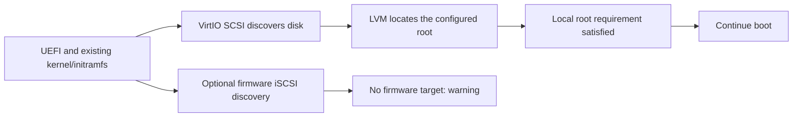

# Storage rebuild and machine preparation

These workflows operate on offline x86_64 Linux disk images. The imported source is preserved, each build uses independent working files, and only a complete validated artifact is published.

## Smaller disks and filesystems

The Storage step separates **virtual disk capacity**, **filesystem capacity**, **used data**, and the imported **file length**. A smaller virtual disk does not predict the size of compressed QCOW2 output or the boot volume a cloud provider will provision. Filesystem reduction does not reduce the outer disk unless a smaller target disk is also selected.

In **Storage**, turn on **Resize** under **Partition sizes**, then adjust each editable filesystem using its slider or numeric field. Numeric fields accept GiB or MiB; GiB values round upward to whole MiB, and ordinary LVM sizes round upward to 4 MiB extents. Fixed EFI partitions retain their original capacity. The bars show used space, planned capacity, and hatched space removed from the original allocation.

Under **Disk capacity**, choose **Fit disk to partitions** to calculate the minimum outer disk for the selected filesystem sizes, including layout metadata, rounded upward to two decimal places in your selected unit. This uses the server's planner and checks the resulting target again. It does not choose smaller filesystem sizes for you. You can also enter a custom capacity or leave it blank to keep the original disk. **Check sizes** and **Next** validate the current plan; estimates do not guarantee that every archive will fit.

Target disk capacity accepts binary GiB or decimal GB. Arbitrary target capacities round upward to a 512-byte boundary; **Disk layout** shows the actual byte count. For example, 10 GB is exactly 10,000,000,000 bytes, or 9.313225746154785 GiB.

**Advanced resizing** retains the direct growth and offline ext2/3/4 shrink path. The **Resize** option uses filesystem rebuild to shrink XFS or an ordinary LVM filesystem. Its preview is available through `POST /api/images/{image_id}/storage/plan`:

```json
{
  "disk_size_gib": 9.313225746154785,
  "storage_rebuild": {
    "enabled": true,
    "sizes": [
      {"device": "/dev/sda2", "size_mib": 512},
      {"device": "/dev/ocivolume/root", "size_mib": 8192},
      {"device": "/dev/ocivolume/oled", "size_mib": 512}
    ]
  }
}
```

The same fields are included in a build recipe. Devices and minimums must come from that image's inspection; this example is not a universal layout. Unspecified filesystems keep their current capacities. The PV occupies the planned remaining space, and LVs use ordinary 4 MiB extents. Rebuild cannot be combined with direct partition changes or automatic partition/LV expansion in the same recipe.

The engine exports each supported filesystem separately with numeric ownership, ACLs, extended attributes and SELinux labels. It copies the EFI system partition byte for byte, creates a new GPT disk and fresh filesystems, restores data and filesystem identities, and compares archive manifests covering content hashes, hardlinks, symlinks, ownership, modes, modification times and archived metadata. Source and destination are attached to separate appliances to avoid duplicate UUID/VG ambiguity. The final export is reinspected and checked against the planned disk layout and filesystem identities, including after format alignment. QCOW2 conversion additionally uses `qemu-img check` and guest-visible byte comparison.

The initial supported rebuild scope is deliberately narrow:

- One GPT disk with 512-byte sectors, detected UEFI support, a single FAT EFI partition first, consecutive partition numbers in physical order, and default GPT attributes. BIOS and dual-mode layouts are blocked because their GRUB block locations would need a separate relocation workflow.
- Direct XFS/ext2/ext3/ext4 filesystems, optionally one ordinary LVM PV and VG with linear LVs and 4 MiB extents. All data filesystems must be known and mountable.
- Non-rescue Linux kernels 5.15 or newer, matching the filesystem creation features of the pinned Debian appliance.
- No encryption, hidden or unsupported data partitions, thin pools, snapshots, RAID LVs, external journals, realtime XFS, or configured quotas/project IDs.

Filesystem UUIDs and labels, GPT identities, partition names and VG/LV names are preserved. Internal PV/VG/LV IDs are regenerated. Detected UUID-pinned boot configuration and active LVM devices files are blockers. LVM rebuild requires the EFI partition to be mounted during inspection so its boot configuration can be checked, including when its mountpoint differs from `/boot/efi`. Readable initramfs metadata is checked for these pins; when the appliance cannot fully decode an initramfs, its unchanged bytes and this limitation are recorded, and a UEFI boot test is required. Filesystem creation features and block layout change; inode numbers, atime/ctime, runtime sockets and inode flags such as immutable or append-only are not preserved by a file-level rebuild. Images that depend on those inode flags need a separate migration workflow.

Minimum sizes include measured use and conservative headroom, but sparse files can expand during archive restoration. The archive's logical contents are checked again before creating the target. Filesystem/OS minimums, package-update headroom and destination boot-volume requirements still need consideration. An insufficient-capacity or verification failure removes unpublished output and leaves the source intact.

## VM to bare metal, and bare metal to VM

**Destination → Hardware compatibility** offers two behaviors. Leave the feature off to keep the existing export workflow; enable it to check or prepare a specific hardware target. Offline images do not establish whether the original machine was virtual or physical, and the target's NIC cannot be inferred from them. Select the actual target hardware driver when using physical networking.

| Behavior | Purpose | Guest changes by hardware preparation |
| --- | --- | --- |
| **Preserve & validate** | Check an image that may already support the destination, including an OCI-native image captured from another machine type | None; retain existing boot files, initramfs, mount references, and networking |
| **Reconfigure** | Prepare an image whose existing configuration needs adaptation | Back up and update mounts, transport arguments, initramfs and explicitly selected network/console settings |

New UI checks start with **Preserve & validate**. Existing API recipes that omit `strategy` retain their previous `reconfigure` behavior. Preservation can check the same declared source and target type; a reconfiguration still requires distinct source and target types. The selected target is checked independently; passing a VM check does not also certify bare-metal compatibility.

Preservation requires actual offline evidence from each non-rescue kernel and its initramfs, a resolvable local root, compatible firmware and destination drivers, and an established network startup path. A missing requirement blocks the check. An unreadable archive, unsupported boot syntax, or unrecognized provisioning implementation is **unknown**, which also prevents export in preservation mode. Neither outcome establishes that the original image cannot boot; it means Forge cannot prove the selected offline prerequisites without further work. Refresh older inspections to collect this evidence.

Oracle initramfs images can combine an early microcode CPIO archive with a compressed main archive. A fingerprint alone does not establish that both archives were inspected. Forge requires readable main-archive evidence, including its drivers, LVM tools and relevant dracut hooks. Standard boot variables are resolved only from inspected literal values; unresolved or dynamic expressions remain unverified.

When the appliance's archive reader cannot decode this layout, a data-only fallback reads raw `newc` CPIO and gzip streams without extracting members or executing guest code. It caps input at 256 MiB, expanded content at 1 GiB, inventory at 100,000 entries and eight archives, retained evidence at 16 MiB, and decoding at 60 seconds. Malformed, ambiguous or unsupported content remains unverified. The fallback adds no guest packages and does not rebuild the initramfs.

OCI guest preparation must be set to **Validate only** while preserving hardware settings. Otherwise it would independently rebuild initramfs and replace networking. Other explicitly requested operations—such as filesystem resizing or edits in Boot & kernel—still run. The preservation baseline is taken after those edits; final verification checks readiness and retained configuration before publishing the converted artifact. This mode does not promise that the entire exported image is byte-identical to the imported source.

`POST /api/images/{image_id}/platform/plan` accepts, for example:

```json
{
  "target": "oci",
  "allow_network": false,
  "platform_migration": {
    "enabled": true,
    "strategy": "preserve",
    "source": "bare_metal",
    "target": "vm",
    "boot_attachment": "paravirtualized",
    "network_attachment": "paravirtualized",
    "nic_driver": null,
    "install_packages": false,
    "configure_network": false,
    "configure_serial_console": false
  }
}
```

Use `strategy: "reconfigure"` to request adaptation. For the experimental bare-metal profile, use `source: "vm"`, `target: "bare_metal"`, iSCSI boot, hardware/VFIO networking and an explicit supported `nic_driver`. UEFI must be detected or provided by an eligible separately enabled BIOS-to-UEFI migration. These profiles are available for OCI and generic exports; they do not convert x86 images to Arm.

Reconfiguration checks installed or built-in drivers for every non-rescue kernel, uses stable UUID mounts, adapts root and boot-transport arguments, and rebuilds generic initramfs with native guest-tool verification. Its broad physical profile includes the selected NIC and NVMe/AHCI support; that bundle is not the minimum needed by an E5 bare-metal iSCSI root. VM PV profiles require VirtIO. Standard GRUB `kernelopts` and `tuned_params` can be resolved from validated, inspected GRUB environment data; unknown or dynamic shell substitutions remain blockers. Existing configuration and unrelated boot arguments are retained or backed up. Networking and serial changes have explicit controls. Required guest packages need both package permission and guest networking; missing kernel drivers are not replaced with guessed packages.

### Optional firmware discovery and local root discovery

The VM3 audit demonstrated a working OCI-native bare-metal image launched unchanged on an E5 Flex VM. The running kernel, initramfs, and `/etc/default/grub` matched the source's SHA-256 hashes. Oracle's generic initramfs already contained both VirtIO and physical NIC/iSCSI drivers. The VM discovered the same LVM/XFS root through VirtIO SCSI while its retained firmware-iSCSI arguments produced nonfatal discovery warnings. Cloud-init configured its new NIC at first boot. [Hardware review](oci-compatibility.md#vm3-native-image-portability)

This is not a universal sequence of “fail iSCSI, then convert to VM.” The existing kernel and initramfs must support the local device. The inspected systemd dracut iSCSI hook accepts an active `initrd-root-device.target` as a completion condition, so local root discovery can satisfy boot without an iSCSI session. Forge reads this archived hook as data; it does not execute guest shell code during inspection. [Dracut firmware-discovery completion](https://github.com/dracutdevs/dracut/blob/master/modules.d/95iscsi/parse-iscsiroot.sh)



Preserve mode only accepts that optional path when the configured root resolves to the imported local filesystem and the archived hook supports local-root completion. An explicit remote root/target, mandatory network boot, missing drivers, conflicting boot entries or unverified archive remains a blocker or unknown. The mere presence of `netroot=iscsi`, the installed dracut package, or a generic-initramfs configuration file is insufficient proof. iSCSI remains essential when the selected destination actually provides its root over iSCSI.

For images intended for multiple OCI machine types, retain working generic driver coverage and stable UUID/LVM references. For a dedicated target, reconfiguration can remove unused discovery and reduce warning noise. Do not remove iSCSI or its physical NIC drivers from an image that must still boot bare metal. A target boot test remains separate from these offline checks.

Preserve networking through either a verified portable DHCP profile or a recognized Oracle cloud-init first-boot implementation with compatible configuration. A copied MAC-bound profile alone is insufficient, but it need not be fatal when the provisioning path will replace it for a new instance. Disabled networking, masked startup units, static overrides, trusted stale cache or unsupported configuration cannot be assumed portable. Cloud-init normally checks the instance identity; explicit cache-trust settings change that behavior. [Cloud-init first-boot determination](https://docs.cloud-init.io/en/latest/explanation/first_boot.html)

The recognized Oracle bootstrap profile is deliberately narrow: Oracle Linux 9.8 with the audited cloud-init 24.4 implementation. Other implementations remain unknown until reviewed. See [the exact bootstrap validation scope](oracle-bootstrap-validation.md).

iSCSI preparation uses standard firmware discovery. It does not invent a server address, IQN, initiator name or credentials. The target firmware must supply valid iBFT/boot connection information. Every kernel must provide `iscsi_tcp` and `iscsi_ibft` (`CONFIG_ISCSI_IBFT`), built in or included in its rebuilt initramfs, alongside the selected storage and NIC drivers.

Verification checks the actual dracut archive for its iSCSI/network modules, command-line hook and firmware-discovery handler. Modern handlers require `iscsiadm`, `iscsid` and `iscsi-iname`, plus the enabled daemon socket and service when using systemd. Legacy handlers require their actual `iscsistart -b` path. A helper binary alone is insufficient. When the appliance cannot decode the archive, guest-native checks produce receipts bound to the exact initramfs path and SHA-256. These checks establish offline prerequisites; they do not test a connection to the target firmware or storage.

When OCI capability preparation is also selected, its settings must agree with the machine profile. Valid previews can account for explicitly planned boot/network changes, but builds apply and verify the actual changes. Subsequent OCI initramfs rebuilding retains the machine profile's required drivers, and final publication repeats the hardware checks against the actual output.

**External BYOI import to bare-metal instances is documented as unsupported.** This is distinct from capturing an existing OCI-native image and launching it on a compatible VM, as VM3 demonstrated. Forge's bare-metal result remains experimental offline hardware preparation, not provider certification or automatic physical deployment. Test the desired firmware, boot transport, networking and destination hardware before using it. This application does not capture running physical hosts or provision machines. The [reference repositories and primary documentation](../sources.md) explain the source material and limits.
